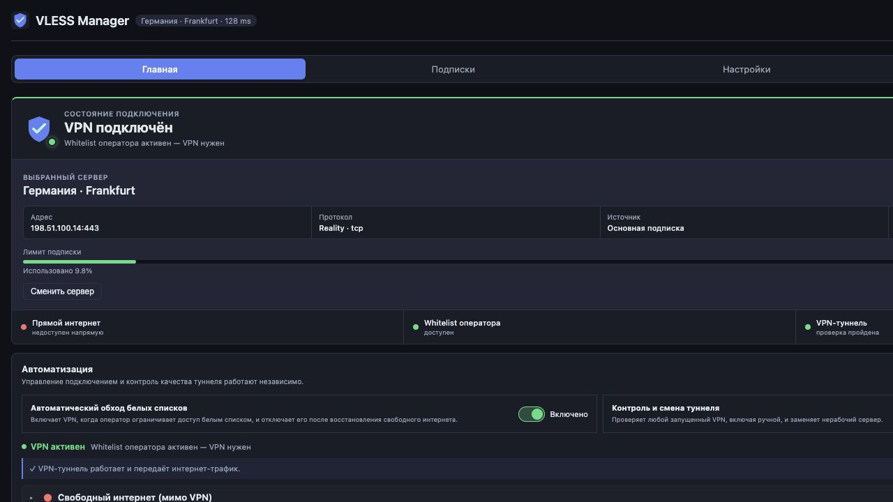

# VLESS Manager

[](https://github.com/wad350/vless-manager/actions/workflows/ci.yml)
[](https://github.com/wad350/vless-manager/releases/latest)

Прозрачный IPv4 VPN для Keenetic с Entware: встроенный Xray, VLESS Reality/TLS,
TCP/UDP через TPROXY, подписки, выбор сервера по ping, health-check и Bypass.
Поддерживаются TCP, WebSocket, gRPC, HTTP Upgrade и XHTTP. TUN не используется.



## Установка и обновление

Нужны Entware `mipsel-3.4` (MT7621) или `aarch64-3.10`, LAN-интерфейс `br0`,
поддержка TPROXY и policy routing в ядре. Выполните на роутере от root:

```sh
curl -fsSL https://raw.githubusercontent.com/wad350/vless-manager/main/install.sh | sh
```

Установщик проверяет архитектуру и SHA-256 последнего стабильного IPK.
Для конкретной версии передайте `VLESS_MANAGER_VERSION=1.18.1` перед `sh`.
Готовые пакеты и история изменений: [GitHub Releases](https://github.com/wad350/vless-manager/releases).
MIPS-пакет включает `iptables`; ARM64 использует установленный Entware `iptables`.

WebUI: `http://router-address:3001`. Добавьте подписку, выберите сервер и включите
VPN. Внешний TCP/UDP, включая публичный DNS и QUIC, проходит через VLESS/XUDP;
LAN, адрес активного сервера и Bypass остаются вне туннеля.

В **Настройки → Система** доступны обновление и changelog из GitHub со всеми
промежуточными версиями. При работающем VPN загрузка сначала идёт через туннель,
при его недоступности — через WAN. Перед установкой проверяются SHA-256,
метаданные IPK и архитектура бинарника. Страница восстанавливает соединение
после перезапуска и показывает фактически запущенную версию.

В **Настройки → Доступ** можно включить вход с учётной записью Keenetic.
Пароль не сохраняется; сессия использует `HttpOnly` cookie с `SameSite=Strict`.
Конфигурация и подписки хранятся в `/opt/etc/vless-manager/`: сохраните этот
каталог перед ручной переустановкой. Журнал процесса: `/tmp/vless-manager/process.log`.

```sh
/opt/etc/init.d/S99vless-manager status
/opt/etc/init.d/S99vless-manager restart
/opt/etc/init.d/S99vless-manager stop
opkg install --force-reinstall /tmp/vless-manager_VERSION_ARCH.ipk
```

## Сборка

Требуется Go 1.27.3. Менеджер, WebUI и Xray входят в один бинарник.

```sh
sh tests/check.sh
make ipk ARCH=mipsel-3.4 GOARCH=mipsle GOMIPS=softfloat
make ipk ARCH=aarch64-3.10 GOARCH=arm64 GOMIPS=
```

Пакеты появляются в `build/`. MIPS использует [криптографический backend](packaging/mipscrypto/README.md);
на проверенном MT7621 init задаёт `GOMAXPROCS=2`, `GOMEMLIMIT=32MiB`, `GOGC=50`.
Явные переменные окружения имеют приоритет. Мягкий лимит Go не ограничивает RSS.

Xray зафиксирован на `v26.10.21` (upstream pre-release); [локальные отличия](xray_src/PATCHES.md).
Тег `vX.Y.Z`, совпадающий с `VERSION` в Makefile, запускает проверку и публикацию
двух IPK с SHA-256. [Изменения текущего выпуска](CHANGELOG.md).

Не добавляйте в Git конфигурацию, UUID, ссылки подписок и пароли.
