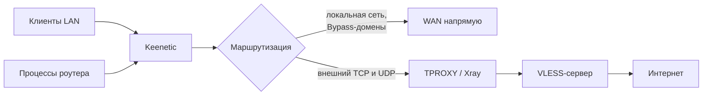
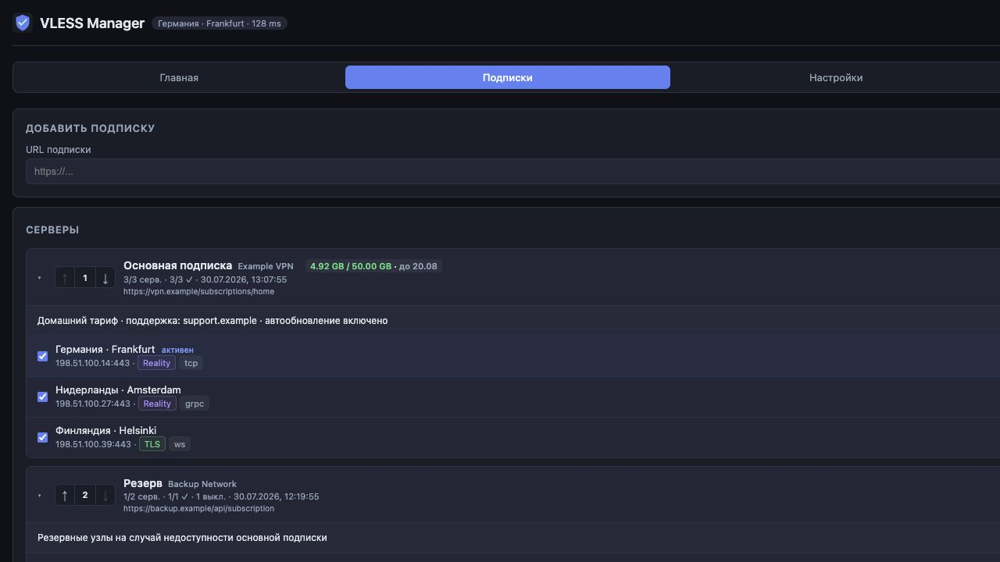
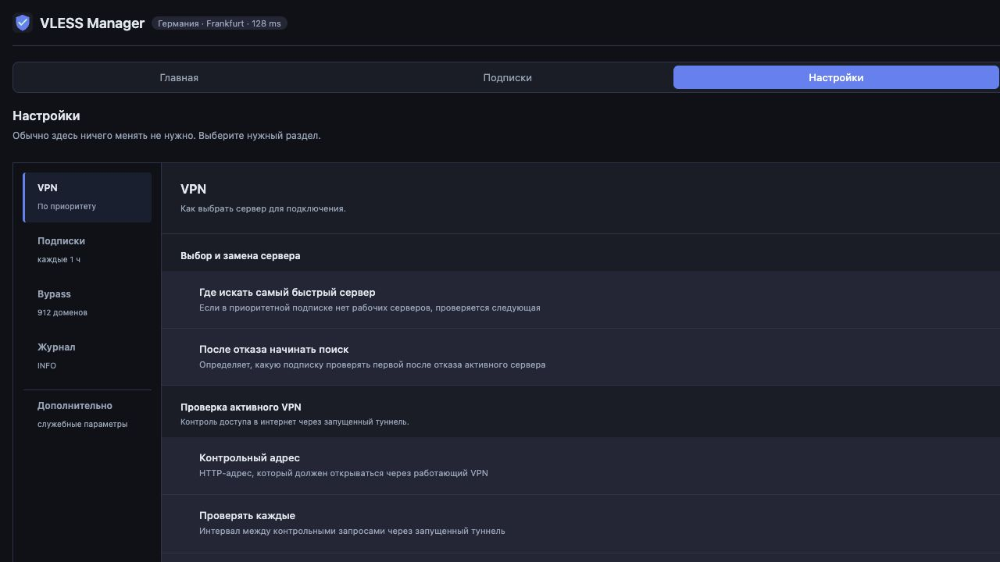
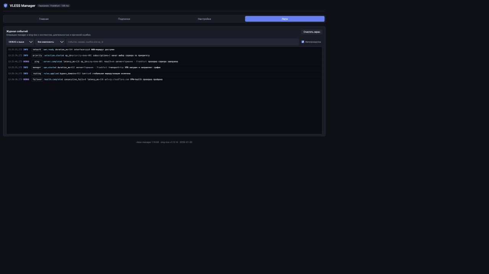

# Руководство VLESS Manager

## Назначение

VLESS Manager превращает Keenetic с Entware в прозрачный VPN-шлюз. Приложения
на телефонах, компьютерах и самом роутере не нужно настраивать отдельно:
TPROXY и policy routing передают IPv4 TCP/UDP в Xray через стек ядра Linux.
Интерфейс `tun0` и пользовательский сетевой стек gVisor не используются.



В текущей сборке Xray встроен в процесс менеджера. Это экономит память и
позволяет получать отдельные счётчики для VPN и Bypass без второго демона.

## Главная


Верхняя карточка показывает:

- запущен ли VPN;
- имя, адрес, протокол и источник активного сервера;
- последний известный HTTP-пинг;
- время работы туннеля;
- квоту и срок подписки, если провайдер передал
  `subscription-userinfo`;
- состояние прямого интернета, whitelist оператора и VPN-health.

Кнопка **Запустить VPN** сначала проверяет все включённые серверы, которые
нужны выбранной стратегии, и только после полного прохода подключает
подходящий узел. Кнопка **Сменить сервер** открывает список подписок.

### Два независимых автомата

**Автоматический обход белых списков** отвечает только за необходимость VPN.
Проверки прямого интернета выполняются всегда. Переключатель разрешает
менеджеру менять состояние VPN по их результату:

| Свободный интернет | Whitelist | Решение |
|---|---|---|
| доступен | любое состояние | VPN не нужен |
| недоступен | доступен | оператор ограничил доступ, VPN нужен |
| недоступен | недоступен | связи нет, запуск VPN не решает проблему |

**Контроль и смена туннеля** отвечает за качество уже запущенного VPN, в том
числе включённого вручную. После заданного числа ошибок VPN-health менеджер
проверяет связь оператора и ищет замену. Этот автомат можно оставить
включённым при выключенном автоматическом обходе whitelist.

### График трафика

Переключатель над графиком выбирает источник:

- **Весь** — трафик интерфейса LAN;
- **VPN** — байты, прошедшие через outbound `proxy`;
- **Bypass** — байты, прошедшие через outbound `direct`.

Скорость отображается в `Кбит/с` и `Мбит/с`, объём — в байтах, MiB и GiB.
Режимы VPN и Bypass доступны только при работающем туннеле. После перезапуска
процесса история графика начинается заново.

## Подписки



### Добавление и обновление

Вставьте URL и при необходимости задайте локальное название. Менеджер
понимает:

- обычный список ссылок `vless://`;
- Base64-кодированный список;
- JSON-конфигурацию Xray с VLESS outbound;
- Clash/Mihomo YAML с VLESS proxy;
- ответы провайдера с именем, описанием, квотой и сроком действия.

Для каждого роутера создаётся постоянный локальный идентификатор клиента. Он
передаётся при загрузке подписок, поэтому парк роутеров не использует один и
тот же ID. Сам URL подписки при этом не изменяется.

Автообновление загружает все включённые подписки с заданным интервалом. Если
включён пункт **Обновлять подписки через работающий VPN-туннель**, туннель
используется только после успешного VPN-health; иначе запрос идёт напрямую.

Обновление не должно останавливать работающий VPN только из-за изменения
каталога. Активная конфигурация продолжает работать до явной замены или
остановки. Удаление подписки также не обрывает уже запущенный туннель.

### Приоритеты

Стрелки рядом с номером меняют порядок подписок. Выключенная подписка целиком
исключается из проверки и выбора. Галка у сервера исключает только этот узел;
неудачный пинг сам по себе галку не снимает.

Доступны две стратегии:

- **В приоритетной подписке** — ищется сервер с минимальной задержкой в первой
  подписке, где есть рабочие узлы. Если рабочих узлов нет, проверяется
  следующая подписка.
- **Во всех подписках** — проверяются все включённые узлы и выбирается
  минимальная задержка независимо от приоритета.

При отказе активного сервера поиск можно начинать с его текущей подписки или
с первой подписки в списке.

### Проверка серверов

Это не ICMP ping. Для каждого узла менеджер:

1. создаёт временную конфигурацию Xray;
2. поднимает локальный SOCKS listener;
3. устанавливает VLESS-туннель;
4. отправляет HTTP-запрос на контрольный URL;
5. сохраняет задержку или причину ошибки.

Такой тест проверяет не только доступность IP и порта, но и TLS/Reality,
транспорт, авторизацию и передачу интернет-трафика.

Число одновременных проверок задаётся в служебных настройках. Значение `1`
включает последовательный режим, большее значение проверяет узлы параллельно.
Менеджер применяет указанное значение без скрытого ограничения по CPU или RAM.

Результаты записываются в `/tmp/vless-manager/ping-cache.json` в RAM и отображаются
после перезагрузки страницы или перезапуска процесса. После перезагрузки самого
роутера кэш может быть пустым. Перед обычным запуском выполняется свежий полный проход; только что
завершённый идентичный проход может быть переиспользован.

### Поддерживаемые узлы

Используется VLESS с Reality, TLS или без TLS. Поддерживаемые транспорты:
`tcp`, `ws`, `grpc`, `httpupgrade` и `xhttp`. QUIC как VLESS-транспорт не
поддерживается новым ядром; обычный UDP/443 передаётся через VLESS/XUDP.
XHTTP обслуживает встроенный Xray core.

Другие протоколы и неподдерживаемые транспорты не попадают в рабочий каталог.

## Настройки



Настройки сгруппированы по задачам.

### Доступ

По умолчанию панель доступна без входа, как и в предыдущих версиях. Опция
**Требовать вход** закрывает WebUI и все рабочие API-методы авторизацией по
учётной записи панели управления Keenetic.

- пароль проверяет сам Keenetic и VLESS Manager его не сохраняет;
- сессия автоматически продлевается при активной работе;
- после пяти неверных попыток вход временно блокируется;
- кнопка **Выйти** завершает текущую сессию на этом устройстве.

Срок сессии задаётся в часах. После перезапуска VLESS Manager активные сессии
сбрасываются, поэтому потребуется войти снова.

### VPN

- область поиска самого быстрого сервера;
- начальная подписка при failover;
- URL, интервал и таймаут VPN-health;
- число ошибок перед заменой;
- пауза между повторными попытками.

### Подписки

- период автоматического обновления;
- загрузка через проверенный VPN-туннель.

### Bypass

- встроенный список российских банков, Госуслуг, Mail.ru, VK, Яндекса и CDN;
- дополнительные домены, по одному в строке;
- ручное обновление готового списка и автоматическое раз в сутки.

Запись `example.com` действует как `domain_suffix` и охватывает
`www.example.com`, `api.example.com` и другие поддомены.

Основной готовый список берётся из `hxehex/russia-mobile-internet-whitelist`.
Менеджер использует только этот готовый список и явно заданные пользователем
домены. Дополнительный список кандидатов и ранее закреплённые кандидаты не
используются. Нет автоматического опроса каждого домена, временных
подтверждений в RAM или таймеров их истечения.
Обновление раз в сутки скачивает один файл, при необходимости через VLESS.
Неизменившийся список повторно на NAND не записывается. Общий список
возвращается в `domains`. Доступность этих адресов зависит от оператора.

### Журнал

Отдельно задаётся подробность VLESS Manager и Xray:

- `ERROR` — только ошибки;
- `WARN` — ошибки и предупреждения;
- `INFO` — обычные операции и итоговые решения;
- `DEBUG` — этапы проверок, загрузок и выбора;
- `TRACE` — максимальная детализация.

Для постоянной работы рекомендуется `INFO` у менеджера и `ERROR` у Xray.
На время диагностики обычно достаточно `DEBUG`.

### Система

Раздел показывает установленную и последнюю опубликованную версии:

1. **Проверить** запрашивает последний GitHub Release.
2. Если VPN запущен, запрос и загрузка сначала идут через его локальный
   SOCKS-вход. При недоступности туннеля менеджер повторяет операцию напрямую.
3. **Установить обновление** запускает фоновую загрузку IPK-пакета и отдельного
   файла SHA-256.
4. Центр обновления показывает этапы, общий процент, загруженный объём,
   скорость и фактически выбранный маршрут.
5. Менеджер проверяет контрольную сумму, метаданные IPK и архитектуру
   вложенного бинарника, затем передаёт пакет `opkg`. Страница ожидает
   перезапуска и подтверждает новую версию.
6. Результат `opkg` и последующего запуска сохраняется в журнале обновления.

Подписки, настройки, кэш пинга и bypass при обновлении не удаляются. Установка
начинается только после явного подтверждения пользователя.

### Дополнительно

Раздел содержит таймеры автоматики, контрольные адреса, лимит параллельных
проверок, ожидание WAN и сетевые таймауты. Менять их следует только при
понятной диагностической причине. Кнопка **По умолчанию** сбрасывает только
текущий раздел, а изменения применяются после **Сохранить**.

## Журнал и диагностика



Запись содержит время, уровень, компонент, событие, поля контекста и
читаемое сообщение. Основные компоненты:

- `manager` — запуск и остановка VPN, конфигурация;
- `network` — WAN и состояние интерфейсов;
- `routing` — TPROXY, iptables и policy routing;
- `subscription` — загрузка и разбор подписок;
- `ping` — тесты серверов;
- `priority` — порядок обхода подписок и выбор;
- `failover` — решения автоматики и VPN-health;
- `bypass` — обновление и применение прямых доменов;
- `update` — проверка релиза, выбранный сетевой маршрут и установка;
- `auth` — успешные и неуспешные попытки входа без паролей и токенов;
- `Xray` — сообщения сетевого движка.

`op_id` связывает начало, промежуточные события и итог одной операции.
Фильтры позволяют выбрать минимальный уровень, компонент или найти сервер,
ошибку и `op_id`.

### Нет интернета после запуска

1. Проверьте карточки **VPN-туннель** и **Маршрутизация**.
2. В логах выберите `routing`, затем `Xray`.
3. Проверьте таблицу `100` с маршрутом `local default dev lo` и цепочки
   `VLESS_TPROXY`, `VLESS_OUTPUT`, `VLESS_IN`.
4. Проверьте, что активный сервер не отключён и поддерживается текущей
   сборкой.

```sh
ip rule show
ip route show table 100
iptables -t mangle -S VLESS_TPROXY
iptables -t mangle -S VLESS_OUTPUT
iptables -S VLESS_IN
```

### Высокая нагрузка

Сначала определите виновника через `top`/`htop`. VLESS Manager использует все
доступные Go-планировщику CPU и не задаёт искусственный лимит памяти. Число
параллельных проверок применяется из настройки без аппаратного ограничителя.
При этом Xray встроен в тот же процесс, а тяжёлые операции выполняются
через единую очередь, чтобы они не меняли общую конфигурацию одновременно.

Большой load average на Keenetic может создавать `ndm` в состоянии `D`, а не
сам VPN. Сопоставляйте load average с CPU, I/O wait и журналом операций.

### Подписка не добавляется

На уровне `DEBUG` журнал показывает размер ответа, формат и причину отказа.
Проверьте:

- доступность URL напрямую и через VPN;
- что ответ содержит VLESS, а не HTML-страницу/капчу;
- что провайдер принимает User-Agent клиента;
- что после фильтрации остался хотя бы один поддерживаемый узел.

### Туннель не меняется

Проверьте, что включён **Контроль и смена туннеля**, VPN-health выполнил
достаточное число попыток, а backoff предыдущего запуска завершён. Затем
отфильтруйте журнал по `failover`, `priority` и общему `op_id`.

## Маршрутизация

Менеджер создаёт прозрачный TCP/UDP-вход Xray на порту `7892`. Таблица `100`
доставляет отмеченные пакеты локально через `lo`, без TUN и gVisor.
Клиентский трафик перехватывается в PREROUTING, трафик самого роутера —
через OUTPUT и loopback. Сокеты выходов Xray и ответов клиентам отмечены
`0x9911`, чтобы избежать повторного перехвата. Исключения:

- private/LAN сети;
- DNS роутера;
- IP активного VLESS-сервера;
- health-check и временные проверки менеджера;
- Bypass-домены.

Внешние TCP и UDP проходят через VLESS. Это включает DNS к публичным
резолверам и QUIC (UDP/443). DNS-запросы к LAN-адресу самого Keenetic остаются
локальными и обслуживаются его DNS-службой.

IPv6 и ICMP не перехватываются. Блокирование QUIC не добавляется; UDP/443
идёт через VLESS. Проверки WAN используют прежнюю socket mark, VPN-health
использует локальный SOCKS-вход. Speedtest подключается непосредственно к
активному ядру Xray через отдельную внутреннюю метку маршрута: Cloudflare и
Speedtest.ru проходят через туннель даже при совпадении с bypass-списком.
Переменные HTTP_PROXY и прозрачный перехват трафика не определяют маршрут
такого замера. Второй процесс Xray не запускается. Счётчики VPN/Bypass остаются
на выходах Xray и не зависят от наличия интерфейса `tun0`.

В ядре нужен `xt_TPROXY`. Менеджер проверяет оба протокола в неприсоединённой
цепочке и при необходимости загружает модуль Keenetic. Если поддержки нет,
возвращается ошибка без автоматического возврата к gVisor. Защита INPUT
блокирует прямое подключение к прозрачному порту. Guard проверяет состояние
четырьмя снимками правил/маршрутов вместо десятков отдельных процессов.

На Keenetic также нужна ранняя обработка отмеченного трафика в `mangle INPUT`:
иначе встроенная защита HTTPS-консоли может отбрасывать перехваченные TLS-пакеты
с исходным портом назначения 443. Менеджер обходит эту обработку только для
своих отмеченных пакетов с LAN и loopback; доступ к веб-панели и остальные
правила Keenetic не изменяются.

UDP-сессии TPROXY разделены по адресу и порту назначения, а не только по
порту клиента. Это важно при переключении между DNS-серверами: VLESS UDP/53
передаёт данные к фиксированному адресу, и повторное использование клиентского
порта не должно отправлять новый запрос в старую сессию. Обычный full-cone
режим SOCKS не изменён.

Init-скрипт очищает текущие и устаревшие правила при старте и остановке. После
аварийного завершения достаточно перезапустить сервис:

```sh
/opt/etc/init.d/S99vless-manager restart
```

### Проверка Native TPROXY На MT7621

В проверке от 11.10.2026 использовались 128 МиБ RAM, `GOMAXPROCS=2`,
`GOGC=50`, `GOMEMLIMIT=32MiB` и один закреплённый gRPC/Reality endpoint.
В менеджер больше не линкуются gVisor, TUN и WireGuard; размер MIPS-бинарника
сократился с 36 503 743 до 30 605 503 байт.

После исправления ключа UDP-сессий прошли три прогона по 512 UDP DNS-запросов
в 32 потока, включая Cloudflare и Quad9. Отдельно проверено переключение
резолвера с сохранением клиентского UDP-порта. Повторные проверки HTTPS и
DoH прошли по 128 запросов в 16 потоков. Bypass, DNS Keenetic, HTTPS самого
роутера, защита прозрачного порта, восстановление INPUT-хука и очистка
после аварийной остановки проверяются отдельно.

Hysteria2-клиент запускался на Mac, не на роутере. Его UDP через TPROXY
и действующий gRPC/VLESS переносился к прежнему Hysteria2-серверу, который
завершал Hysteria2 и открывал соединения к сайтам. Прошли 16 HTTPS, 16 DoH,
32 UDP DNS, скачивание 8 МиБ и отправка 2 МиБ. Внешние VPN-счётчики
подтвердили передачу вложенного трафика. Speedtest менеджера завершился
с подтверждённым туннелем: 13.8 Мбит/с вниз и 18.5 Мбит/с вверх.

Полностью успешное скачивание 24 МиБ дало 66.3 CPU ticks/МиБ процесса
против прежних 124.7 на TUN. Это отдельные измерения, не гарантия прироста
пропускной способности. В последующих параллельных загрузках Cloudflare
были TLS-таймауты и сбросы; похожие сбои воспроизводились через SOCKS без
TPROXY. Повторные HTTPS-прогоны обоих путей прошли. Причина TLS-сбоев
не установлена, поэтому полная стабильность всех нагрузок не заявляется.

Экспериментальные настройки, профили и пакетные трассы размещались в RAM.
Криптография оставалась в Go-режиме; настройки модема, FastNAT и early demux
после диагностики возвращены к исходным значениям. Исходный бинарник
сохранён на Mac с проверкой SHA-256 перед постоянной установкой.

## Ресурсы и ограничения платформы

Пакеты собираются для Keenetic OS с Entware `mipsel-3.4` на MT7621 и
`aarch64-3.10` на ARM64. Миграцию Xray на роутере следует проверять отдельно.

- TCP/UDP используют стек ядра; отдельного TUN MTU нет;
- Go toolchain фиксирован на `1.27.2`;
- Xray фиксирован на prerelease `v26.10.10` с локальными исправлениями;
- бинарник не сжимается UPX: на MT7621 такой бинарник аварийно завершался;
- лимит открытых файлов процесса повышается до `65536`;
- `/proc/sys/fs/file-max` повышается до `131072`;
- XHTTP обслуживается встроенным Xray.

Перед миграцией менеджер сохраняет `config.json.before-xray` и
`subscriptions.json.before-xray` в том же каталоге для восстановления каталога
узлов, если часть старых транспортов не поддерживается Xray.

## Файлы на роутере

| Путь | Назначение |
|---|---|
| `/opt/bin/vless-manager` | исполняемый файл |
| `/opt/etc/vless-manager/config.json` | конфигурация и настройки |
| `/opt/etc/vless-manager/subscriptions.json` | подписки и ручные исключения |
| `/tmp/vless-manager/ping-cache.json` | результаты тестов в RAM |
| `/tmp/vless-manager/update-status.json` | состояние проверки обновлений в RAM |
| `/tmp/vless-manager/manager.pid` | PID процесса в RAM |
| `/opt/etc/vless-manager/device-hwid` | постоянный ID этого роутера |
| `/tmp/vless-manager/process.log` | stdout/stderr процесса в RAM |
| `/tmp/vless-manager-update.log` | журнал установки обновления в RAM |
| `/opt/etc/init.d/S99vless-manager` | управление сервисом и очистка маршрутов |

Файлы подписок и конфигурации содержат секреты. Не публикуйте их в issue,
скриншотах или репозитории.

### Снижение записей на NAND

Настройки, адреса подписок, учётные данные узлов, ручные исключения, квоты и сроки
действия сохраняются постоянно. Неизменившиеся данные не переписываются.
Время последней проверки подписки, временная ошибка загрузки и текущий расход
трафика обновляются в памяти без отдельной записи каталога на flash. После
перезагрузки эти сведения могут быть старее, пока подписка не обновится.

Восстановимые кэши и служебный вывод размещаются в `/tmp`. Старые кэши из
`/opt/etc/vless-manager` читаются для совместимости, но больше не обновляются.
Путь RAM-кэшей задаётся аргументом `-runtime-dir` или переменной
`VLESS_MANAGER_RUNTIME_DIR` для init-скрипта. Выбирайте tmpfs, а не NAND.
Кольцевой журнал веб-интерфейса ограничен 500 записями и не хранится на диске.
Эти изменения не перенастраивают журнал самого Keenetic, файловую систему
или swap других программ.

На MT7621 со 128 МиБ RAM сам исполняемый файл оставляйте на постоянном
накопителе. Полная копия движка в tmpfs отнимает десятки МиБ и может переполнить
ZRAM ещё до запуска. В RAM размещаются небольшие восстановимые данные, а не
весь пакет. Для оценки свободной памяти используйте `MemAvailable` из
`/proc/meminfo`: сумма cache/free из панели может включать занятый tmpfs.

### Диагностика Производительности

В разделе «Дополнительно» настройка «TLS-профиль соединения» позволяет выбрать
ChaCha20 для CPU без доступного движку ускорения AES-GCM. Это отдельный randomized-профиль uTLS,
а не точная имитация Chrome. TLS 1.3, минимум TLS 1.2, проверка сертификатов
и согласование AES с сервером сохраняются. Настройка действует на активный
туннель и проверки серверов; исходные записи подписок и идентификаторы не
изменяются. Отдельные TLS-настройки download-ветки XHTTP не переписываются.
Смена профиля перезапускает VPN; во время проверки серверов она отклоняется.
По умолчанию выбран профиль сервера. При несовместимости верните его.

На MT7621 со 128 МиБ RAM 11.10.2026 проведено сравнение AES / ChaCha20 /
ChaCha20 / AES на одном gRPC/Reality-сервере. Скачивание 8 МиБ четырьмя
потоками дало 7.38 и 7.70 Мбит/с с исходным профилем против 14.16 и
15.37 Мбит/с с новым. Процессорные затраты на одинаковый объём снизились
примерно на 33%. Это измерение конкретного роутера и мобильного подключения,
а не гарантированная скорость всех серверов или протоколов.

После исправления hybrid key share для REALITY проверены 24 запуска с новыми
TLS-отпечатками без ошибок. Нагрузочный прогон прошёл 32 одновременных
TCP-скачивания, 64 DoH-запроса с параллельностью 32 и 256 UDP-запросов с
параллельностью 64. Сервер не менялся, туннель и веб-панель оставались доступны.
Дополнительно 64 TCP-загрузки передали 64 МиБ за 51.5 секунды без ошибок с
таймаутом 80 секунд. С таймаутом 40 секунд большинство файлов не успели
догрузиться; OOM и потери управления не было. Рост параллельности не гарантирует
рост скорости и увеличивает расход RAM.
После закрытия UDP-сессий без перезапуска число goroutine вернулось с
примерно 1050 к 32, RSS процесса снизился примерно до 31 МиБ.
Текущий таймер активности Xray может закрывать неактивное соединение через
два интервала проверки: при стандартном интервале 300 секунд это до 10 минут.

Аргумент запуска `-diagnostics` включает служебные адреса:
`/api/diagnostics/runtime`, `/api/diagnostics/cpu?seconds=10` и
`/api/diagnostics/heap` и `/api/diagnostics/goroutines`. По умолчанию они выключены. Доступ требует локального
адреса клиента и действительной сессии входа, даже если обычная авторизация UI
выключена. Профили CPU ограничены 15 секундами, одновременно снимается только
один профиль. Файлы передаются клиенту напрямую без сохранения на роутере.
Принудительная сборка мусора при снятии heap-профиля не выполняется.
Для запуска через init-скрипт можно временно задать
`VLESS_MANAGER_DIAGNOSTICS=1`. Не включайте диагностику постоянно без необходимости.

### Буферы И gRPC

Сборка `v26.9.9+manager.6` сохраняет пакетное чтение Xray даже за обёрткой
счётчиков трафика. Данные gRPC передаются следующему обработчику без повторного
копирования в буфер 8 КиБ; уже прочитанный префикс не возвращается повторно.
Сохраняются UDP-адрес назначения, таймауты и подсчёт байтов, в том числе при
возврате данных вместе с ошибкой. Обычные TCP-сокеты и подсчёт частичной записи
работают по прежним правилам. DNS, маршруты и настройки подписок не меняются.

На проверенном MT7621 микробенчмарк чтения через счётчик стал примерно в
3.4 раза быстрее для 1200 байт и в 6.7 раза для 8192 байт; передача небольшого
gRPC-пакета стала примерно вдвое быстрее. Это отдельные операции с буферами,
не ускорение всего VPN во столько же раз. Живые сетевые прогоны зависят от
мобильной сети и сервера; таймауты TLS наблюдались и на контрольной сборке.

На проверенном MT7621 с двумя физическими ядрами и четырьмя VPE init-скрипт
включает ограниченную MIPS32r2-реализацию ChaCha20: `VLESS_MANAGER_MIPS_CHACHA20=auto`.
Проверка ISA остаётся обязательной; остальные MIPS по умолчанию используют Go.
Для явного отключения задайте `VLESS_MANAGER_MIPS_CHACHA20=generic`.
На этом MT7621 также включается `VLESS_MANAGER_MIPS_POLY1305=auto`; для
отключения только Poly1305 задайте `VLESS_MANAGER_MIPS_POLY1305=generic`.
Оптимизации буферов работают и без ассемблера.

### Экспериментальная Криптография MIPS

Следующий эксперимент объединяет блоки ChaCha20 в один ассемблерный вызов
размером не более 16 КиБ. Состояние и счётчик не разделяются между goroutine;
параллельная работа идёт на независимых соединениях. Ограничение размера вызова
сохраняет возможность вытеснения Go между пакетами. На MT7621 выигрыш относительно
предыдущей ассемблерной версии составил около 3% для буфера 16 КиБ.
Это не новый четырёхкратный выигрыш относительно уже ускоренной версии.

Проверка полного ChaCha20-Poly1305 на двух потоках дала около 24.6 МБ/с против
11.9 МБ/с у Go. Четыре потока почти не улучшили результат. Это скорость
криптографического примитива, а не всего VPN. В профильном замере скачивания
ChaCha20 занимала около 14.7%, а Poly1305 около 8.3% учтённых CPU-сэмплов;
остальная работа включает сетевой стек, системные вызовы, буферы и GC.

Прежний эксперимент Poly1305 с шестью произведениями не дал устойчивого
выигрыша. Новый backend переносит весь цикл полных блоков в MIPS-ассемблер:
умножение, переносы и ту же частичную редукцию. Ключи, формат состояния,
неполный хвост, финализация и проверка тега остаются совместимыми со штатным Go.
Вызов ограничен 16 КиБ; дополнительная память не выделяется.
На `192.168.201.1` три чередующихся замера полного ChaCha20-Poly1305 на двух
потоках дали для блока 16 КиБ 25.30 → 38.89 МБ/с при шифровании и
25.14 → 38.98 МБ/с при расшифровании. Для 1200 байт прирост составил около 50%.
Поэтому init-скрипт включает новый backend на проверенном MT7621 с двумя ядрами
и четырьмя VPE. `VLESS_MANAGER_MIPS_POLY1305=generic` отключает только его;
`VLESS_MANAGER_MIPS_CHACHA20=generic` отключает оба. Это скорость криптографии,
а не гарантия такого же прироста скорости интернета.

На самом MIPS проверены случайные произведения с переносами, полные состояния
MAC, RFC-векторы, неверные теги, границы буферов, счётчиков и восемь независимых
потоков с принудительным GC. Эти проверки не заменяют криптографический аудит.
Предыдущие результаты живого gRPC/VPN не подтвердили устойчивого прироста скорости:
диапазоны старой и новой сборок перекрываются. В одном новом прогоне были три
HTTPS-таймаута; UDP-таймауты наблюдались и на контроле, и в Go-режиме.
Последний повторный Go-прогон прошёл 12 загрузок, 32 HTTPS, 64 DoH и 256 UDP
без ошибок. В том раннем эксперименте сборка роутера была оставлена в Go-режиме.
Следующая проверка после перехода на native TPROXY описана ниже.
Служебные журналы и тестовые настройки размещались только в RAM.

### Проверка Обновления Xray 26.10.10

Локальная сборка `v26.10.10+manager.25` сохраняет исправления TPROXY, UDP
batching, gRPC, изоляции DNS и учёта трафика. Новый upstream MASQUE, как TUN
и WireGuard, включается отдельным build tag; обычный менеджер не линкует gVisor.
Зависимость `x/crypto` обновлена до `v0.57.0`. Исходные ChaCha20, Poly1305 и AEAD
в этой версии совпадают с проверенной `v0.55.0`; генератор проверяет их хеши.

На MT7621 повторно прошли нативные криптотесты с 1/2/4 потоками Go и тесты
UDP batching. В трёх замерах AEAD на двух потоках с одинаковым ускоренным
ChaCha20 медианы штатного и ассемблерного Poly1305 составили:

| Блок | Операция | Штатный Poly1305 | Ассемблер |
| --- | --- | --- | --- |
| 1200 байт | Шифрование | 20.63 МБ/с | 30.05 МБ/с |
| 1200 байт | Расшифрование | 20.13 МБ/с | 27.90 МБ/с |
| 16 КиБ | Шифрование | 19.07 МБ/с | 30.75 МБ/с |
| 16 КиБ | Расшифрование | 24.34 МБ/с | 37.89 МБ/с |

Полный race-прогон менеджера, короткий race-прогон всех пакетов Xray,
отдельные tagged-тесты и сборка ARM64 прошли. Короткий прогон Xray включает
сетевые сценарии; ему потребовался общий timeout 600 секунд, прежние лимиты
180/240 секунд были недостаточны. Это не проверка всех возможных внешних
серверов и сетевых условий.

На живом роутере подтверждены HTTPS и UDP DNS через VPN, HTTPS bypass
и локальный HTTP. Счётчики и захват WAN согласуются с каждым маршрутом;
в bypass остаются 910 доменов. Cloudflare speedtest завершился с
29.24/16.51 Мбит/с, полезные данные учтены в режимах «Весь» и «VPN».
Speedtest.ru в двух попытках получил TLS timeout: сначала при загрузке
списка серверов, затем после частичного скачивания. Этот сбой не устранён.

Hysteria2 с новой учётной записью проверена с Mac: 24 HTTPS, 24 DoH,
48 UDP DNS, 12 загрузок по 1 МиБ и 12 отправок по 256 КиБ прошли.
Mac штатно использует другой домашний шлюз, поэтому для проверки цепочки
на MIPS применялось временное UDP-реле с единственным фиксированным
назначением. Захват подтвердил вход тестового трафика в LAN и отсутствие
прямого выхода к Hysteria2-серверу на WAN; VPN-счётчики подтвердили объём.
Реле, порт и диагностические правила удалены; маршрут Mac не менялся.

Первый диагностический прогон был некорректен: временное разрешение реле
ставилось перед защитным INPUT-хуком менеджера, запускало восстановление
маршрутизации и создавало короткий промежуток прямого выхода UDP. После
исправления порядка тестового правила повторный прогон прошёл без
восстановления маршрутов и без прямых UDP-пакетов. Это исправление стенда,
а не доказательство исправления ошибки Xray или ядра Linux.

### Таймеры, UDP И Ассемблер В Native TPROXY

В `v26.9.9+manager.16` таймауты используют Go-таймер с остановкой, а не отдельную
спящую goroutine. Незавершённое чтение сохраняется после таймаута; интерфейс
UDP-соединений, пакеты и счётчики не меняются. Попытка делегировать дедлайны
непосредственно нижнему reader исключена: нагрузочные UDP-прогоны давали
нестабильные результаты как на старой, так и на новой сборке.
Не-QUIC пакеты отбрасываются sniffing-парсером до получения буфера почти 32 КиБ;
это не блокировка UDP и не отключение определения доменов.

На Linux прозрачный IPv4 UDP принимается пачками до восьми пакетов через
`recvmmsg`. Исходный адрес назначения хранится отдельно для каждого пакета;
учтены dual-stack сокеты Go, используемые даже при адресе `0.0.0.0`.
Одиночный пакет не ждёт заполнения пачки. Для отключения используйте
`XRAY_TPROXY_UDP_BATCH=off`. Другие типы сокетов сохраняют прежний приём.
Крупные пакеты с усечёнными данными или ancillary data не передаются как целые.

Свежий профиль M12 на MT7621 показал примерно 25% CPU в ChaCha20, 19% в Poly1305
и 14% в системных вызовах. После включения ограниченного ассемблера ChaCha20
составила около 7-8% CPU в обычном gRPC-скачивании. Успешные прогоны 24 МиБ дали
64.8-71.0 CPU-тиков на МиБ в Go против 51.3-53.8 с ассемблером.
Итоговая M16 с реально работающим batching прошла 24 загрузки, 64 HTTPS,
64 DoH и 256 UDP без ошибок. Это экономия CPU в конкретной нагрузке,
не обещание скорости LTE. В отдельном UDP-стрессе на 512 запросов / 32 потока
новая M16 прошла 481/512, повторная M12 — 448/512; ранее M12 проходила 512/512.
Причина таймаутов не установлена; эти результаты не доказывают ни регрессию,
ни отсутствие проблемы и не скрываются за повторными попытками.

Hysteria2 запускался на Mac: его UDP шёл через TPROXY и gRPC/VLESS роутера
к прежнему Hysteria2-серверу. Четыре полных прогона с ассемблером прошли
HTTPS, DoH, UDP DNS, скачивание и отправку; байты подтверждены внешними VPN-счётчиками.
Итоговая M16 также прошла 16 HTTPS, 16 DoH, 32 UDP, скачивание 8 МиБ
и отправку 2 МиБ. Измерено около 12 Мбит/с вниз и 5.3 Мбит/с вверх;
это результат вложенной цепочки в текущей мобильной сети, не предел шифра.
В ранних контрольных и новых нагрузочных прогонах были TLS-таймауты и сбросы;
их причина не установлена, отсутствие ошибки в последнем прогоне их не исключает.

Модем уже работал через USB 3.0 (5000 Мбит/с линка) и QMI raw-IP с MTU 1500.
В сравнении RPS 0 → 1 → 0 устойчивого выигрыша не получено; исходный RPS 0
восстановлен. Счётчики ошибок и потерь QMI не увеличились. Скорость USB-линка
не равна скорости мобильного интернета. Прошивка, APN и режим радиосети не менялись.
Единственный swap — `/dev/zram0`, сжатая оперативная память, а не NAND.

В M17 остановка/истечение UDP-сессии сразу отменяет её контекст и освобождает
очередь пакетов. Завершение старой сессии не удаляет новую с тем же tuple;
отключённый worker не создаёт сессии из оставшихся в очереди callback.
Таймаут активности и правила маршрутизации не сокращались и не менялись.

UDP receive-only буфер теперь не обнуляется целиком перед системным вызовом:
наружу передаются только фактически записанные ядром байты. Обычные Buffer
Extend/Resize по-прежнему обнуляют новые области. Обрезанные UDP-пакеты
отбрасываются и в одиночном Linux-приёме, как уже было в batching.
Повторные тесты на MIPS проверили разные длины, порты, poisoned tail,
отключённый batching и dual-stack сокеты. Микротест подготовки 8 КиБ буфера
дал примерно 4.3-4.6 мкс до изменения против 0.19 мкс после;
это цена подготовки буфера, не скорость сети или шифрования.

Дополнительные измерения M16: 512/512 UDP прошли без роста ошибок ядра.
В прогоне 1024/32 без batching прошли 959 запросов, с batching — 1023;
в обоих прогонах счётчики UDP receive buffer/softnet drops не увеличились.
Это не установило причину оставшихся сетевых таймаутов и не доказывает,
что все предыдущие проблемы были связаны с batching или исправленным lifecycle.

Итоговая M17 прошла 24 загрузки, 64 HTTPS, 64 DoH и 256 UDP без ошибок;
цена обычного скачивания составила 52.4 CPU-тиков/МиБ. Отдельный стресс
Quad9 — 1024/1024 запросов в 32 потока; Cloudflare — 995/1024 с таймаутами.
Полная цепочка Mac Hysteria2 → UDP TPROXY → gRPC/VLESS → прежний Hysteria2-сервер
прошла 16 HTTPS, 16 DoH, 32 UDP, скачивание 8 МиБ и отправку 2 МиБ.
Счётчики внешнего VLESS подтвердили весь объём. Причина редких DNS-таймаутов
не установлена; обновление не объявляется их исправлением.

Проверенный DW5821e-eSIM Snapdragon X20 LTE уже подключён по USB 3 со скоростью
линии 5000 Мбит/с. Это скорость USB, не сотового интернета. В проверенных счётчиках
softnet не было сброшенных пакетов. Настройки модема, QMI, MTU, очереди CAKE,
частота CPU и прошивка для этих экспериментов не менялись.

### Экспериментальный TCP-Стек

Добавлены два независимых эксперимента, выключенных по умолчанию:

- `VLESS_MANAGER_TUN_TCP_BATCH=1`: передача уже полученных MultiBuffer в
  gVisor блоками не более 32 КиБ без отдельного большого буфера и ожидания
  следующих данных. Учитываются фактически принятые байты; сохраняются
  таймауты, частичная запись, backpressure и закрытие соединения.
- `VLESS_MANAGER_TUN_TCP_BUFFER=128k`: начальные send/receive-буферы TCP
  по 128 КиБ и максимальные по 512 КиБ вместо исходных мегабайтных диапазонов.
  Это буферы TCP между устройством в LAN и TUN-стеком, не буферы TCP
  внешнего gRPC-соединения с VPN-сервером. UDP и ICMP не изменены.

На MT7621 меньшие буферы дали три локальных прогона двух TCP-стеков по
5.03-5.15 МБ/с без TLS и внешней сети. При пакетной подаче стало меньше
аллокаций, но число пакетов осталось примерно тем же: 48 на 64 КиБ.
Это не ускорение VPN и не устранение системных вызовов TUN.

Пять живых прогонов через одну запись gRPC/Reality-сервера включали
60 попыток скачивания по 1 МиБ, 160 HTTPS-проверок, 320 DoH и 1280 UDP-запросов.
Параллельность составляла 4 для TCP/HTTPS/DoH и 8 для UDP. Счётчики VPN
подтвердили передачу полезных данных через туннель. Скорость успешных загрузок
составляла 11.1-13.7 Мбит/с, а CPU-затраты остались около 136 тиков на МиБ.
Устойчивого выигрыша нового режима не установлено; таймауты HTTPS/DoH и UDP
наблюдались и с исходными настройками. Штатная сборка и настройки роутера
восстановлены, новые эксперименты автоматически не включаются.

Проверены порядок данных, частичные записи, учёт ошибок, освобождение буферов,
пробуждение при backpressure, смена deadline, закрытие, параллельные записи,
IPv4/IPv6 и FIN; есть проверки гонок и тесты на самом MIPS. Все тестовые
настройки и журналы размещались в RAM; после проверки временная сборка
удаляется с NAND. Отдельный эксперимент с TCP через ядро Linux описан ниже.

### Предыдущий Эксперимент: TCP REDIRECT

Этот эксперимент сохранён ниже как история измерений, но больше не доступен
в менеджере. Текущая архитектура использует TPROXY для обоих протоколов;
старые флаги `VLESS_MANAGER_TCP_REDIRECT` и `VLESS_MANAGER_TUN_TCP_*` не влияют
на неё. Прежний экспериментальный запуск с `VLESS_MANAGER_TCP_REDIRECT=1` переводил IPv4 TCP
клиентов и самого роутера на Linux TCP + NAT REDIRECT + Xray dokodemo-door.
TCP больше не проходит через gVisor. UDP по-прежнему идёт через TUN и VLESS;
ICMP и остальные IP-протоколы остаются напрямую, как в обычном режиме.
Это не аппаратное ускорение TLS: шифрование и транспорт до VPN-сервера
по-прежнему выполняются Xray.

Без явно заданного флага используется прежний TUN. При отсутствии поддержки
REDIRECT установка завершится ошибкой, частично установленные правила
будут удалены. Автоматического переключения на другой режим нет.
В `/api/status` поле `routing_mode` показывает `kernel-tcp` или `tun`.

Локальные сети, адреса самого роутера, активный VPN endpoint и отмеченные
WAN-сокеты исключены из перехвата. Доменные bypass-правила, health-проверки,
speedtest и счётчики VPN/Bypass используют прежние выходы Xray. Служебный
порт 7892 принимает только перенаправленные TCP-соединения от LAN и локальных
процессов; прямые подключения блокируются. Режим не добавляет FakeIP,
DNS-перехват или перехват IPv6.

Менеджер сохраняет выбранный режим при восстановлении правил. Проверяется
порядок NAT-хуков и защита входа; init-скрипт очищает собственные NAT/filter
цепочки даже после аварийного завершения. Старый init-скрипт нужно обновить
вместе с бинарником, иначе он не знает новых цепочек после `kill -9`.
Диагностика и экспериментальные настройки должны оставаться в RAM.

На MT7621 в сравнении от 11.10.2026 использовались один gRPC/Reality endpoint,
`GOMAXPROCS=2` и прежнее шифрование без экспериментального ассемблера.
В двух полностью успешных загрузках по 12 МиБ затраты процесса составили
124.7 CPU ticks/МиБ на TUN против 67.3 на kernel-tcp; скорость была
14.5 против 19.4 Мбит/с. Суммарные busy ticks из `/proc/stat` по всему роутеру,
включая ядро, составили 131.8 против 76.5 на МиБ (около 42% снижения
в этом сравнении). В отдельных 10-секундных CPU-профилях с загрузкой
16 МиБ процесс потратил 17.56 против 8.98 CPU-секунд; образцов gVisor TCP
в профиле kernel-tcp не было. Это снижение затрат **процесса**, а не замер
всего CPU роутера: часть работы переносится в ядро Linux. Суммарные kernel
счётчики выше замерялись отдельно; это не обещание такого же выигрыша
на других серверах и типах трафика.

Пять сетевых прогонов включали 60 загрузок по 1 МиБ, 160 HTTPS, 320 DoH
и 1280 UDP DNS. Таймауты и TLS-сбросы встречались в обоих режимах;
в экспериментальных прогонах DoH/UDP ошибок было больше. Длинный speedtest
на kernel-tcp завершился TLS handshake timeout, контрольный на TUN прошёл
(14.8/14.4 Мбит/с, передача через туннель подтверждена). Причина различий
не установлена, поэтому устойчивое ускорение и равная надёжность не заявляются;
эксперимент не включён постоянно, штатная сборка роутера восстановлена.

После обнаружения FakeIP от другого прокси в DNS Mac сравнение повторено
с явными IPv4-адресами, полученными от DNS Keenetic и одинаковыми во всех
повторных прогонах. В четырёх полных прогонах проверены 48 загрузок,
128 HTTPS, 256 DoH и 1024 UDP DNS. Оба контрольных прогона TUN прошли
без ошибок. На kernel-tcp прошли 22/24 загрузки, 62/64 HTTPS, 118/128 DoH
и 472/512 UDP DNS. Таким образом, TLS/UDP-сбои нельзя списывать только
на DNS Mac; экспериментальная маршрутизация пока не считается готовой
для постоянного использования на этом роутере. Значения CPU и скорости
в предыдущем абзаце относятся к повторному сравнению с явными DNS-адресами.

Отдельно проверена цепочка Hysteria2/Gecko через уже подключённый gRPC VLESS.
Клиент Hysteria2 запускался на Mac с привязкой к LAN-интерфейсу, не вторым
тяжёлым процессом на роутере. В каждом режиме прошли 8 HTTPS, 8 DoH,
16 UDP DNS, скачивание 4 МиБ и отправка 1 МиБ без ошибок; рост внешних
VPN-счётчиков подтвердил маршрут. Скорость составила 8.2-9.3 Мбит/с вниз
и 5.0-5.3 вверх. Для этой UDP-цепочки выигрыша нового TCP-режима не установлено.

На живом роутере также проверены доменный bypass со счётчиком ByPass,
локальный DNS, TCP самого роутера, запрет прямого доступа к порту 7892,
восстановление удалённого NAT-хука, штатная остановка и очистка после `kill -9`.
Тесты менеджера и MIPS-шифрования, включая race-проверки новой маршрутизации,
проходят. Общий `go test ./...` отдельно не проходит из-за недостающих модулей
в старом `singbox_src`; это не включено в утверждение о пройденных тестах.

### Аппаратные Возможности MT7621

У MIPS1004Kc в проверенном MT7621 два физических ядра. CPU0 и CPU1 делят
первое ядро, CPU2 и CPU3 второе: четыре аппаратных потока не равны четырём
независимым ядрам. Init-скрипт распознаёт эту топологию по `/proc/cpuinfo` и
задаёт `GOMAXPROCS=2`, если пользователь не задал значение явно.
Это ограничивает одновременно исполняемый код Go, но не количество клиентских
соединений, не число системных потоков и не доступные ядру Linux CPU.
На других SoC, при неизвестной топологии и на ARM64 поведение не меняется.
Для сравнения можно задать `GOMAXPROCS=4` при запуске init-скрипта.

В двух повторных сравнениях на одном gRPC/Reality-сервере с ChaCha20
скачивание 8 МиБ требовало 1412/1454 CPU ticks при четырёх потоках Go
против 1034/1034 при двух. Для 16 МиБ результат составил 2822/2790 против
1983/2053. Это около 28% снижения процессорных затрат на скачивание,
а не обещание такого же роста скорости. Единичные TLS-сбросы и таймауты
наблюдались в контрольных и экспериментальных прогонах; неуспешные передачи
не включаются в сравнение скорости. Причина этих сбоев отдельно не установлена.

В ядре проверенного Keenetic загружен `eip93_cryptoapi`. Он регистрирует
аппаратные AES-ECB/CBC/CTR и сочетания для IPsec, но не аппаратный AES-GCM
или ChaCha20-Poly1305. Go TLS также не использует ядровую Crypto API
автоматически. Поэтому наличие блока AES на плате не делает текущий VLESS/TLS
аппаратно ускоренным. Поддерживаемые режимы описаны в
[исходниках драйвера EIP93](https://github.com/openwrt/openwrt/blob/main/package/kernel/linux/modules/crypto.mk).
Менять безопасные TLS-шифры на CBC ради этого ускорителя нельзя.

Ethernet IRQ и RPS/XPS уже распределены Keenetic по разным физическим ядрам.
Менеджер не меняет эти настройки, частоту CPU, напряжение или NAT-offload.
Не допускается ускорение пересылки в обход перехвата VPN. RPS для USB-модема
проверяется отдельно и не включается автоматически: перенос обработки пакетов
имеет цену в виде межпроцессорных прерываний и не гарантирует ускорение одного
мультиплексированного gRPC-соединения.
См. [документацию Linux по RPS/XPS](https://docs.kernel.org/networking/scaling.html).
